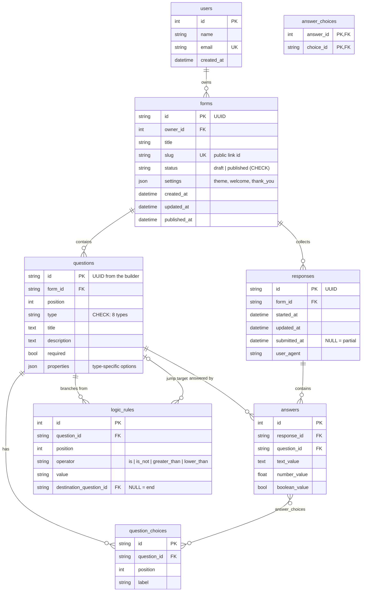

# Typeform Clone (formly)

A full-stack clone of Typeform: build forms in a drag-and-drop builder with a live preview, publish them with a shareable link, collect answers through the one-question-at-a-time conversational flow, and read the results.

- **Frontend:** Next.js 16 (App Router) + TypeScript, CSS Modules, Framer Motion, dnd-kit
- **Backend:** Python 3.12 + FastAPI, SQLAlchemy 2, Pydantic 2
- **Database:** SQLite

> The product is branded **formly** in the UI (one constant in `frontend/src/lib/brand.ts`) so it does not reuse Typeform's trademark, while the layout and interactions follow Typeform's.

---

## Contents

1. [Features](#features)
2. [Running locally](#running-locally)
3. [Deployment](#deployment)
4. [Architecture](#architecture)
5. [Database schema](#database-schema)
6. [API overview](#api-overview)
7. [Key implementation decisions](#key-implementation-decisions)
8. [Assumptions & limitations](#assumptions--limitations)
9. [Tests](#tests)

---

## Features

### Core
| Area | What's there |
| --- | --- |
| **Builder** | Three-panel layout (content list · live canvas · settings). Add questions from a type picker, edit titles, descriptions and choices **inline on the canvas**, reorder by **drag and drop** (mouse or keyboard), duplicate and delete. Per-question settings: required, description, plus type options (multiple selection, rating steps and shape, number min/max, max characters). Desktop/mobile canvas toggle and a full-screen **Preview** that runs the real respondent flow without saving. Autosave with a status indicator. |
| **Question types** | Short text, long text, multiple choice (single or multi), dropdown (type to filter), email, number, yes/no, rating (stars or 1–10 scale). |
| **Form management** | Workspace list (list or grid view) with status, response count, search and sort. Create, rename (in the list or inline in the builder header), duplicate, delete, publish and unpublish. |
| **Respondent flow** | `/to/<slug>`, no login. One question at a time, full screen, with vertical slide transitions, a progress bar, and up/down navigation. Keyboard: **Enter** = OK, **Shift+Enter** = new line, **↑/↓** = previous/next, **A–Z** picks a choice, **Y/N** for yes/no, **1–9/0** for ratings. Single-click answers auto-advance. Validation on both client and server (required, email, number range, rating range, valid choice ids). Welcome and thank-you screens. |
| **Results** | Insights (starts, submissions, completion rate, average time to complete). **Summary**: per-question stats (choice counts and percentages, rating distribution and average, number avg/min/max, latest text answers). **Responses**: a table of submissions with a slide-over showing one response in full, bulk delete, and completed/partial tabs. |
| **Typeform UX** | Modals, toasts, inline editing, "Coming soon" placeholders (integrations, team, templates, extra question types, more share options). |

### Bonus features implemented
- **Logic jumps:** "if answer is / is not / > / < X, go to question Y or the end", evaluated identically on client and server.
- **Custom themes:** 6 presets plus 5 colour pickers and 8 fonts.
- **CSV export** of responses (UTF-8 with BOM for Excel, protected against formula injection).
- **Partial-response tracking** and completion rate: a response is created when the respondent starts and is saved as they go.
- **Dark mode** for the creator app.

---

## Running locally

Prerequisites: **Python 3.12+** and **Node.js 20.9+**.

### 1. Backend (http://localhost:8000)

```bash
cd backend
python -m venv .venv
# Windows: .venv\Scripts\activate    macOS/Linux: source .venv/bin/activate
pip install -r requirements-dev.txt
uvicorn app.main:app --reload --port 8000
```

On first start the database (`backend/typeform.db`) is created and seeded with a creator, two published forms with 55 responses (plus partial ones), and one draft. To reset it:

```bash
python -m app.seed --reset
```

Interactive API docs: http://localhost:8000/docs

### 2. Frontend (http://localhost:3000)

```bash
cd frontend
npm install
cp .env.example .env.local   # NEXT_PUBLIC_API_URL=http://localhost:8000
npm run dev
```

### Environment variables

| Where | Variable | Default | Purpose |
| --- | --- | --- | --- |
| backend | `DATABASE_URL` | `sqlite:///backend/typeform.db` | SQLAlchemy URL |
| backend | `CORS_ORIGINS` | `*` | Comma-separated allowed origins |
| backend | `SEED_ON_STARTUP` | `true` | Seed demo data when the DB is empty |
| frontend | `NEXT_PUBLIC_API_URL` | `http://localhost:8000` | Backend base URL (inlined at **build** time) |

---

## Deployment

The frontend goes to **Vercel**; the backend goes to **Render** (free tier).

### Backend on Render
1. Push this repository to GitHub.
2. In Render, choose **New → Blueprint** and select the repo. `render.yaml` configures everything: the `backend/` root, Python 3.12.4, the build and start commands, and the health check at `/api/health`.
3. Once it's live, open `https://<your-service>.onrender.com/api/health` and check it returns `{"status":"ok"}`.

> Render's free tier has an **ephemeral disk**: the SQLite file is recreated (and re-seeded) on every deploy or restart, and the service sleeps after inactivity, so the first request can take about 50 s. For persistent data, attach a Render Disk (paid) mounted at `/var/data` and set `DATABASE_URL=sqlite:////var/data/typeform.db`. A `Dockerfile` is also included for Railway, Fly.io or Cloud Run.

### Frontend on Vercel
1. **Add New → Project**, import the repo, and set **Root Directory** to `frontend` (the framework is detected as Next.js).
2. Add the environment variable `NEXT_PUBLIC_API_URL` = `https://<your-service>.onrender.com` (no trailing slash).
3. Deploy. If you change the variable later, **redeploy**, because it's baked in at build time.
4. Optional: set `CORS_ORIGINS` on Render to your Vercel URL to lock the API down.

---

## Architecture

```
┌──────────────────────── Next.js (frontend/) ────────────────────────┐
│ app/                      routes (thin: they only pick a component)   │
│   /                       Workspace                                   │
│   /forms/[id]/layout      FormEditorShell → FormEditorProvider        │
│     create | workflow | connect | share | results                     │
│   /to/[slug]              PublicForm → FormRunner (live)              │
│ components/                                                           │
│   runner/    the respondent experience (also used by the builder)    │
│   builder/   question list (dnd-kit), canvas, settings panels         │
│   editor/    editor context (state + autosave), header, tabs          │
│   results/   summary, responses table, response drawer                │
│   workspace/ form list, create dialog, actions menu                   │
│   ui/        Modal, Toast, Menu, Toggle, Icon...                      │
│ lib/         api client, types, validation, logic, pure edit helpers │
└───────────────────────────────┬──────────────────────────────────────┘
                                │ JSON over HTTPS (CORS, no cookies)
┌───────────────────────────────▼───────── FastAPI (backend/) ─────────┐
│ routers/    forms (creator CRUD) · results (creator) · public         │
│ services/   forms · responses · validation · logic · stats            │
│ schemas.py  Pydantic request/response models (the API contract)       │
│ models.py   SQLAlchemy ORM = database schema                          │
│ errors.py   domain errors → HTTP status codes (handlers in main.py)   │
└───────────────────────────────┬──────────────────────────────────────┘
                                ▼
                         SQLite (typeform.db)
```

**Backend layering.** Routers parse and validate HTTP input (Pydantic) and call services. Services hold the business logic and raise domain errors (`NotFoundError`, `ConflictError`, `AnswerValidationError`) that know nothing about HTTP; `main.py` maps them to status codes. That keeps the services unit-testable and the routers a few lines each.

**One runner, three uses.** `FormRunner` and `QuestionView` render the public form, the builder's full-screen **Preview** (`mode="preview"`, nothing saved) and the builder **canvas** (an `editing` prop turns title, description and choices into inline inputs). That's why the live preview matches the published form exactly. The runner uses CSS container queries, not media queries, so the "Mobile" toggle in the builder shows the real mobile layout inside a narrow frame.

**Builder state and autosave.** `FormEditorProvider` holds the form. Edits go through `update(fn)`, where `fn` is one of the pure helpers in `lib/formEditing.ts` (insert, duplicate, delete, move, update). After 700 ms of inactivity the whole definition is `PUT` to the server. Saves are serialised (never two in flight), the response's metadata is merged without overwriting text the user is still typing, and pending changes are flushed before publishing, switching tabs or leaving the page.

---

## Database schema



### Design notes
- **Normalised where it matters for querying.** Questions, choices, logic rules, responses and answers are separate tables with foreign keys. All foreign keys use `ON DELETE CASCADE` (enforced with `PRAGMA foreign_keys=ON`), so deleting a form removes everything under it and deleting a question removes its answers.
- **Typed answer columns.** Each answer stores its value in the column matching the question type (`text_value`, `number_value` or `boolean_value`). Choice answers link to `question_choices` through **`answer_choices`**, a many-to-many table that also covers multi-select. Summary statistics are therefore exact counts by choice id, and renaming a choice label doesn't break historical answers.
- **JSON only for display configuration.** Theme, welcome and thank-you screens (`forms.settings`) and type-specific options (`questions.properties`) are never queried, vary by type, and are validated by Pydantic models on every write, so JSON columns avoid a dozen sparse columns or side tables.
- **Stable client-generated ids.** The builder creates UUIDs for questions and choices, so a logic rule can point at a question that hasn't been saved yet. On save the server **upserts by id** instead of delete-and-recreate, which keeps existing answers linked. It also rejects ids that belong to another form.
- **Partial responses.** A response row is created when the respondent starts, and `submitted_at` stays `NULL` until they submit. Completion rate is `submitted / started`. Uniqueness: one answer per `(response_id, question_id)`.
- **Constraints and indexes.** CHECK constraints on `forms.status`, `questions.type` and `logic_rules.operator`; a unique `forms.slug`; composite indexes on `(form_id, position)`, `(form_id, submitted_at)` and `(owner_id, updated_at)` for the hot queries.

---

## API overview

Base URL: `/api`. Full interactive docs at `/docs` (OpenAPI).

### Creator: forms
| Method | Path | Description |
| --- | --- | --- |
| GET | `/forms?search=&sort=updated\|created\|title` | List forms with status, question count and response count |
| POST | `/forms` | Create a form `{title}` |
| GET | `/forms/{id}` | Full definition (settings, questions, choices, logic) |
| PUT | `/forms/{id}` | Save the whole definition (builder autosave) |
| PATCH | `/forms/{id}` | Rename `{title}` |
| DELETE | `/forms/{id}` | Delete the form and everything under it |
| POST | `/forms/{id}/duplicate` | Deep copy as a new draft (ids and logic remapped) |
| POST | `/forms/{id}/publish` · `/unpublish` | Change status |

### Creator: results
| Method | Path | Description |
| --- | --- | --- |
| GET | `/forms/{id}/responses?completed=true&limit=&offset=` | Paginated responses (`completed=false` for partial) |
| GET | `/forms/{id}/responses/{rid}` | One response |
| POST | `/forms/{id}/responses/delete` | Bulk delete `{ids: [...]}` |
| GET | `/forms/{id}/summary` | Insights and per-question statistics |
| GET | `/forms/{id}/export.csv` | CSV download |

### Public: respondents (no auth)
| Method | Path | Description |
| --- | --- | --- |
| GET | `/public/forms/{slug}` | Published definition (404 for drafts) |
| POST | `/public/forms/{slug}/responses` | Start a response → `{id}` |
| PATCH | `/public/forms/{slug}/responses/{rid}` | Save progress `{answers}` (format checked, required not) |
| POST | `/public/forms/{slug}/responses/{rid}/submit` | Final submit, full validation along the logic path |

Answers are sent as `{question_id: value}`, where value is a `string`, `number`, `boolean` or a list of choice ids. A validation failure returns **422** with per-question messages:

```json
{ "detail": "Some answers are invalid",
  "errors": [{ "question_id": "…", "message": "Hmm... that email doesn't look right" }] }
```

Other: `GET /api/health`, `GET /api/me` (the default creator).

---

## Key implementation decisions

- **Logic is implemented twice, on purpose.** `backend/app/services/logic.py` and `frontend/src/lib/logic.ts` are line-for-line equivalents. The client needs it to choose the next question instantly, and the server needs it to know which questions were actually on the respondent's path: a required question skipped by a jump must not block submission, and answers to skipped questions are dropped. Jumps can only go **forward**, which rules out loops by construction.
- **Validation is also mirrored.** Server rules in `services/validation.py` are the source of truth, and the client copy in `lib/validation.ts` gives instant feedback with the same messages. If the server still rejects a submission, the runner jumps back to the first offending question and shows the error.
- **Animations.** Framer Motion `AnimatePresence` with a direction-aware variant: the next question slides up, going back slides down. Choice clicks blink briefly and then auto-advance, as in Typeform. Callbacks fired from timers read state through a ref, so a late auto-advance can never act on a question the respondent has already left.
- **No auth.** `deps.get_current_user` returns the seeded default creator, and every creator query is scoped by `owner_id`, so adding real auth only changes that one dependency.
- **No migration tool.** The schema is created with `create_all` at startup. For a project of this size with a seeded SQLite database, Alembic would add ceremony without benefit; it would be the first addition for a production version.

---

## Assumptions & limitations

- A single default creator (no login), as the brief allows.
- Editing a **published** form updates it live; there are no draft/live versions. Deleting a question that already has answers asks for confirmation.
- Advanced logic (calculations, variables), integrations, team sharing, templates, file upload, payments and extra question types are visible as **"Coming soon"** placeholders.
- The builder is designed for desktop and stacks vertically on small screens; the respondent flow is fully responsive.
- Free-tier hosting is ephemeral (see [Deployment](#deployment)).

---

## Tests

```bash
cd backend && pytest
```

The tests cover CRUD and duplication, reorder with stable ids, draft privacy, server validation for every type, logic-aware required checks, partial responses, summary statistics, CSV export, and cross-form id protection. The frontend is type-checked by `npm run build`; `npm run lint:format` checks Prettier formatting.

### Project layout

```
backend/
  app/{main,config,database,models,schemas,deps,errors,question_types,seed}.py
  app/routers/   forms.py results.py public.py
  app/services/  forms.py responses.py validation.py logic.py stats.py
  tests/
frontend/
  src/app/         routes
  src/components/  runner/ builder/ editor/ results/ workspace/ ui/
  src/lib/         api.ts types.ts logic.ts validation.ts formEditing.ts ...
render.yaml        Render blueprint (backend)
```
